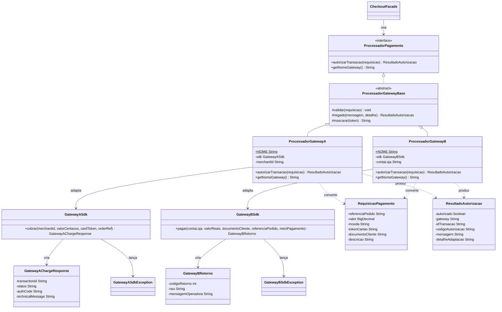

# Diagrama de classes — Adapter

Padrão estrutural **Adapter** no pacote `br.edu.unirv.esw430.checkout.patterns.adapter`.

A interface alvo é `ProcessadorPagamento`. `ProcessadorGatewayA` e `ProcessadorGatewayB` convertem a `RequisicaoPagamento` do checkout para as assinaturas incompatíveis de `GatewayASdk` (centavos e status textual) e `GatewayBSdk` (double e código numérico) e devolvem um `ResultadoAutorizacao`. A validação da requisição, o mascaramento do token e o resultado negado ficam em `ProcessadorGatewayBase`. O `CheckoutFacade` depende só da interface alvo.

Versão PlantUML: [adapter.puml](adapter.puml).
