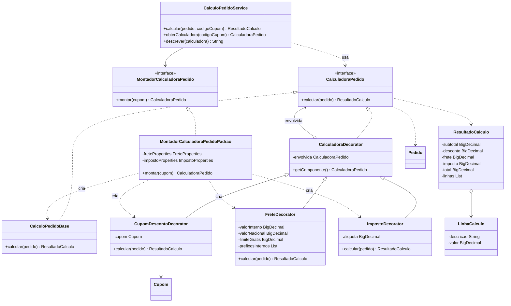

# Diagrama de classes — Decorator

Padrão estrutural **Decorator** no pacote `br.edu.unirv.esw430.checkout.patterns.decorator`.

`CalculadoraPedido` é o componente. `CalculoPedidoBase` soma os itens. `CalculadoraDecorator` guarda o componente envolvido. `CupomDescontoDecorator`, `FreteDecorator` e `ImpostoDecorator` acrescentam, cada um, uma responsabilidade ao `ResultadoCalculo`.

`MontadorCalculadoraPedidoPadrao` só compõe a cadeia (subtotal, cupom quando existe, frete e imposto). Ele não é um quarto padrão GoF: a ordem fica fora dos decoradores para o imposto continuar enxergando o desconto.

Versão PlantUML: [decorator.puml](decorator.puml).
