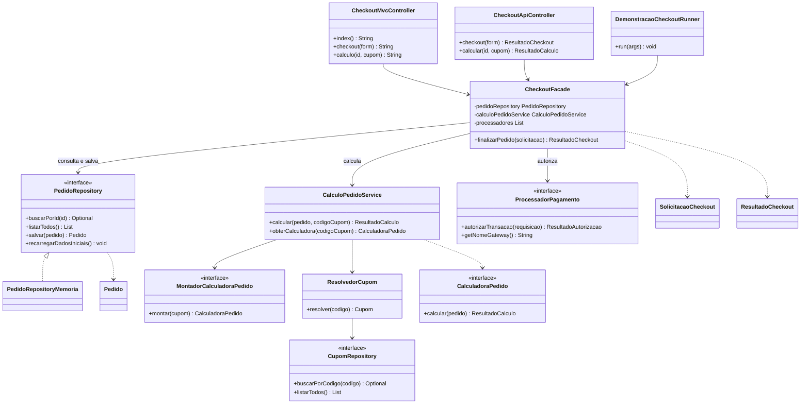

# Diagrama de classes — Facade

Padrão estrutural **Facade** na classe `CheckoutFacade`.

O método `finalizarPedido` é a operação de alto nível. Ele consulta e valida o pedido pelo `PedidoRepository`, obtém o valor pela cadeia de `CalculadoraPedido` (via `CalculoPedidoService`), autoriza a cobrança por um `ProcessadorPagamento` e emite o `ResultadoCheckout` com o comprovante quando o pagamento é aprovado.

Os subsistemas Adapter e Decorator estão detalhados em [adapter.md](adapter.md) e [decorator.md](decorator.md).

Versão PlantUML: [facade.puml](facade.puml).
